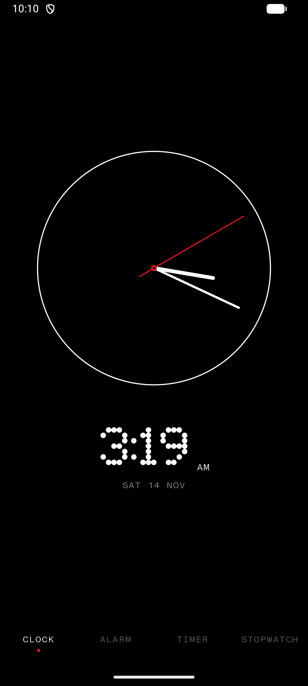
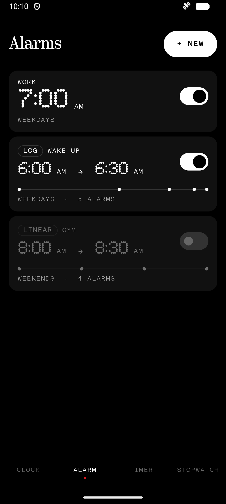
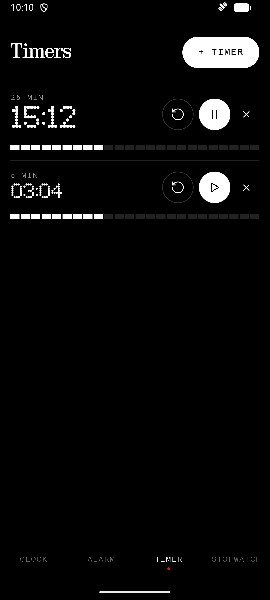
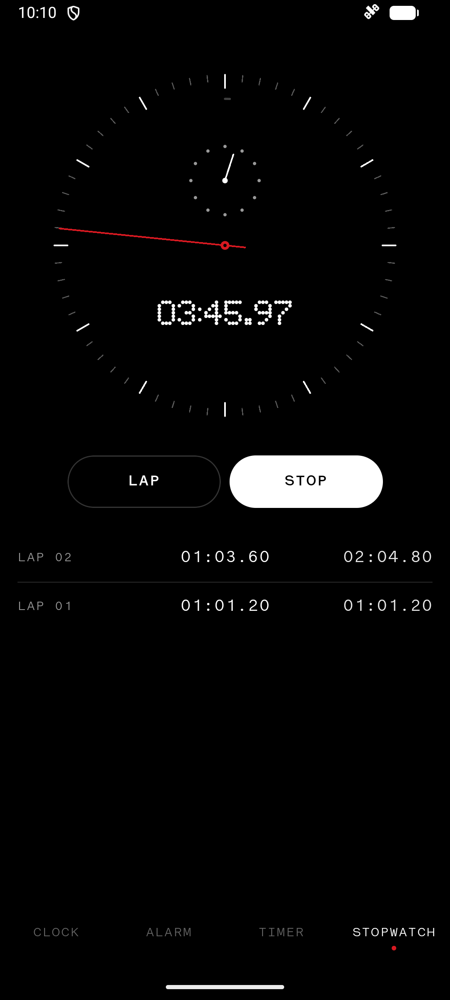
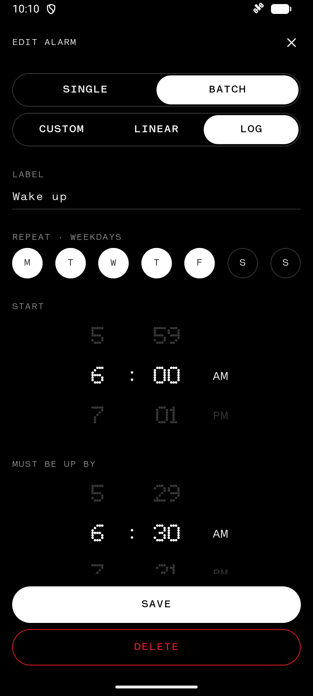
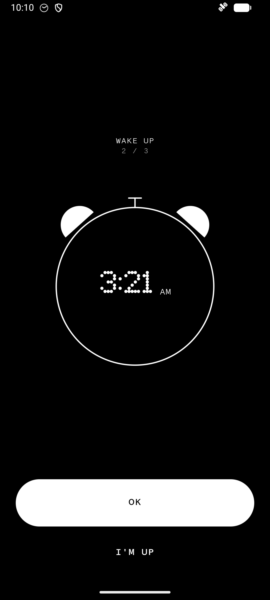
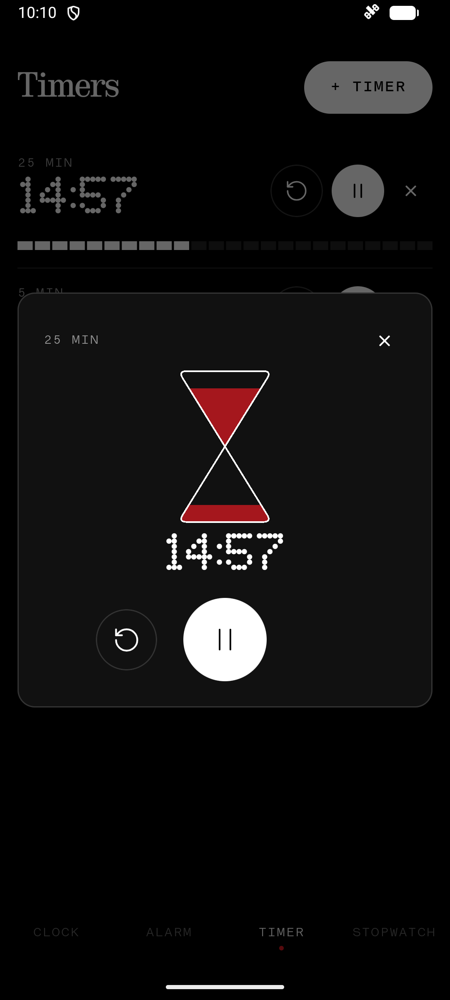

# CLOC

A minimal clock app for Android in the Nothing design language: OLED black, dot-matrix numbers, and red only where it matters.

<p>
  
  
  
  
</p>

## Features

### Clock
A clean analog dial (a thin ring, white hands, a red seconds hand) with the digital time and date underneath.

### Alarms
- **Single alarms** that repeat on chosen days or ring once. They have a **SNOOZE** button.
- **Batch alarms**: a group of alarms that you switch on and off together. Three kinds:
  - **CUSTOM**: pick the first alarm, then add more with the `+2 +5 +10 +20 +30 +60` bubbles or a custom gap.
  - **LINEAR**: a start time, an interval and a count.
  - **LOG**: a start time and a "must be up by" time. The gaps halve each time (rounded to whole minutes, never under 1 min), so the alarms get closer together as the deadline nears.
- Batch alarms have no snooze. You get a big **OK** that stops the current ring, and a small **I'M UP** that skips the rest of that batch for today.
- Alarms ring over the lock screen, and are rescheduled after a reboot or a time zone change.

<p>
  
  
</p>

### Timers
- Run several timers at once. Each one has a segmented progress bar, play/pause and reset.
- Tap a timer to open the hourglass view. The red sand drains at a steady rate, and there's a large play/pause and a reset.

<p>
  
</p>

### Stopwatch
An analog stopwatch:
- seconds round the edge;
- a minutes sub-dial;
- a faint hour arc;
- a digital readout in the centre;
- laps with split and total times.

## Requirements
- Android 12 (API 31) or newer.
- **Notifications** and **Alarms & reminders** permissions. The app will ask for them.

## Install
Open the signed `CLOC-x.y.apk` on your phone, or build it yourself as shown below. You may need to allow installs from unknown sources.

## Build
You need JDK 21 and the Android SDK (API 37).

```sh
./gradlew assembleDebug        # debug APK  → app/build/outputs/apk/debug/
./gradlew testDebugUnitTest    # unit tests for the batch maths and scheduling
```

For a signed release build, create a `keystore.properties` in the project root. It is gitignored, so never commit it.

```properties
storeFile=/path/to/your-release.jks
storePassword=...
keyAlias=...
keyPassword=...
```

Then run `./gradlew assembleRelease`.

## Tech
- **Stack:** Kotlin and Jetpack Compose. Material 3 only does plumbing; every visible component is custom and drawn to the Nothing design rules.
- **Scheduling:** `AlarmManager.setAlarmClock` handles alarms, and a foreground service with a full-screen notification does the ringing.
- **Storage:** state is saved in SharedPreferences as JSON. There's no database.

## Licence
CLOC is free software. You can redistribute it and/or modify it under the terms of the [GNU General Public License v3.0](LICENSE).

These are third-party assets with their own licences:
- the Ndot, NType and Lettera Mono fonts, which belong to their respective owners;
- the reset icon, which is [Lucide](https://lucide.dev)'s `rotate-ccw` (ISC licence).

CLOC is not affiliated with Nothing Technology Limited.
